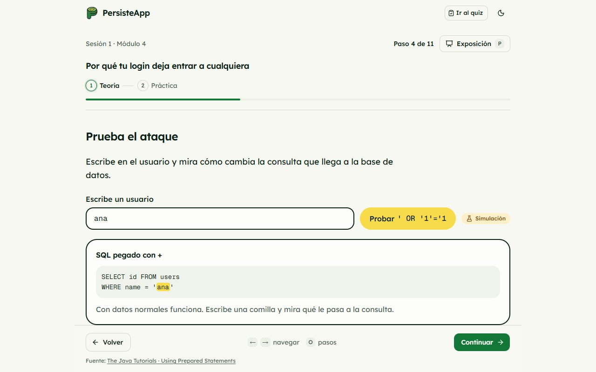
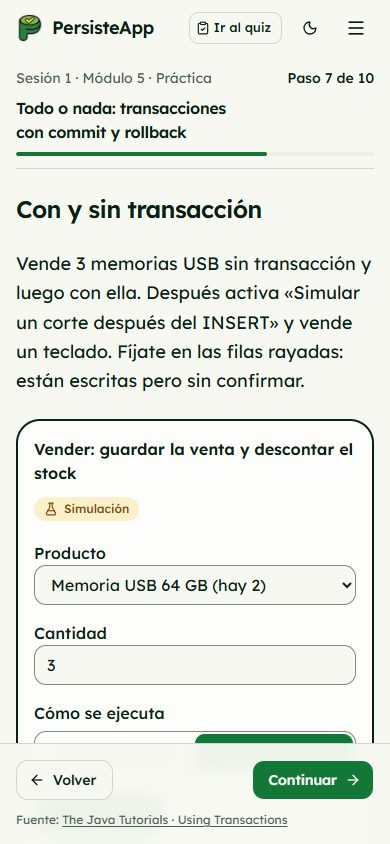
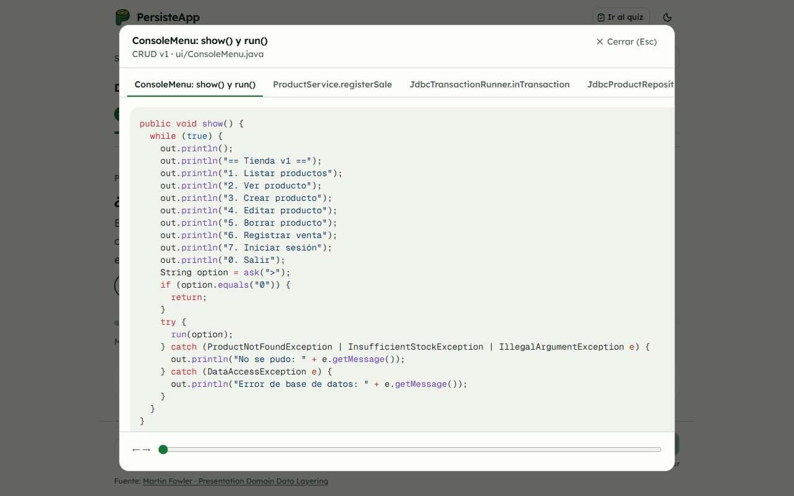
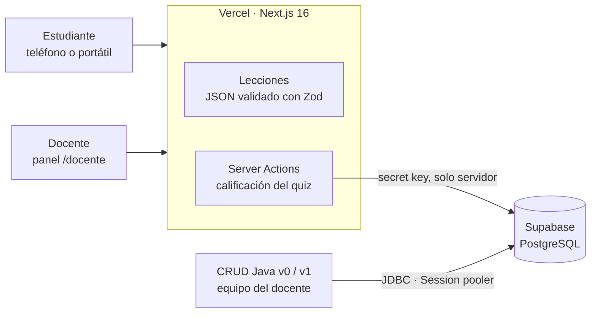

<div align="center">

<picture>
  <source media="(prefers-color-scheme: dark)" srcset="docs/logo/persisteapp-oscuro.png" />
  
</picture>

<h3>Lo que registras, queda guardado.</h3>

Plataforma interactiva para aprender cómo una aplicación Java se conecta a una base de datos:<br/>
JDBC, pool de conexiones, consultas seguras, transacciones y arquitectura en capas.

[](https://persisteapp.vercel.app)

<a href="#stack"></a>

[**Abrir la app**](https://persisteapp.vercel.app) · [Requisitos](specs/01-requirements.md) · [Diseño](specs/02-design.md) · [CRUD Java](crud/README.md)

</div>

<p align="center">
  
</p>

## Contexto

PersisteApp acompaña la **sesión 1 de persistencia** de *Programación de Computadores III* (Ingeniería de Sistemas, Universidad Popular del Cesar). Reemplaza las diapositivas por un recorrido que el estudiante sigue en su teléfono o portátil mientras el docente lo proyecta, y cierra con un quiz en vivo que arma el ranking del grupo.

- **Docente:** Ing. Esp. Alfredo David Bautista Romero
- **Autor:** [Daniel David Turizo Chacón](https://github.com/ddturizo-eng)

## Qué incluye

| | |
|---|---|
| **7 módulos, 98 minutos** | Cada módulo va de la teoría a la práctica, una idea por pantalla. El build falla si el plan pasa de 100 minutos. |
| **Simuladores interactivos** | Pool de conexiones, inyección SQL frente a `PreparedStatement` y un espejo app ↔ base de datos para ver `commit` y `rollback`. Todos se rotulan como **Simulación**. |
| **«¿Dónde ocurre?»** | Recorridos que preguntan en qué archivo, clase, red o base de datos ocurre cada paso de una petición. |
| **«Ver código»** | Las preguntas que dependen de código abren el fragmento exacto del CRUD de referencia, verificado contra el archivo real en las pruebas. |
| **Quiz final en vivo** | 10 preguntas calificadas en el servidor, tiempo por pregunta según lo que hay que leer, nota de 0 a 5 y ranking por grupo. |
| **Panel docente** | Salas por grupo, vista en vivo, resultados por pregunta y por estudiante, rehabilitación de bloqueos y exportación a CSV. |
| **Integridad** | Aviso y bloqueo por salir de la pestaña, sin copiar ni menú contextual, marca de agua con el nombre del estudiante. |
| **Modo Exposición** | Tecla `P`: oculta la navegación y agranda el contenido para el proyector, con cronómetro. |
| **Accesible** | Teclado completo, contraste WCAG AA en tema claro y oscuro, 375 px sin scroll horizontal, progreso local por módulo. |

### Módulos de la sesión 1

| # | Módulo | Min |
|---|---|---|
| 1 | Qué viaja entre tu código y la tabla | 15 |
| 2 | Tu primera conexión: driver, URL y clave fuera del código | 12 |
| 3 | Por qué abrir una conexión por consulta es lento: el pool | 15 |
| 4 | Por qué tu login deja entrar a cualquiera | 20 |
| 5 | Todo o nada: transacciones con commit y rollback | 12 |
| 6 | Del clic a la fila: las capas de tu aplicación | 12 |
| 7 | Lo que ves es lo que se guarda: el CRUD completo | 12 |
| 8 | Qué hace Spring Boot por ti *(opcional, estudio autónomo; no entra en el quiz)* | 15 |

<table>
  <tr>
    <td width="62%"></td>
    <td rowspan="2"></td>
  </tr>
  <tr>
    <td></td>
  </tr>
</table>

## Arquitectura



- **Contenido como datos.** Cada lección es un JSON tipado en `web/content/s1/`; un solo reproductor dibuja todos los pasos. El esquema se valida en el build.
- **Sin servidor propio.** Todo lo dinámico corre en funciones serverless de Vercel contra Supabase. El panel docente consulta cada 5 s.
- **Ranking justo.** Las respuestas correctas nunca viajan al navegador: el servidor califica, cuenta solo el primer intento y aplica el límite de tiempo.
- **Sin credenciales en el cliente.** La clave de Supabase vive solo en variables de entorno del servidor.

Las reglas completas están en [`specs/00-constitution.md`](specs/00-constitution.md).

## Stack

| Capa | Tecnología |
|---|---|
| Web | Next.js 16 (App Router), React 19, TypeScript, Tailwind CSS 4 |
| Interfaz | React Aria Components, lucide-react, GSAP |
| Código resaltado | Shiki (temas GitHub claro y oscuro, ajustados a contraste AA) |
| Validación | Zod |
| Datos | Supabase (PostgreSQL) |
| Pruebas | Vitest |
| Despliegue | Vercel |
| CRUD de referencia | Java 17, Maven, JDBC, HikariCP; PostgreSQL u Oracle |

## Estructura

```
PersisteApp/
├── web/                  App Next.js
│   ├── app/              Rutas: landing, /s1/[lección], /s1/quiz, /sala, /docente
│   ├── components/       Reproductor de lecciones, simuladores, quiz y panel docente
│   ├── content/s1/       Lecciones, quiz y fragmentos de código (JSON)
│   ├── lib/              Lógica pura: esquema, calificación, tiempos, pool, reportes
│   ├── supabase/         SQL del quiz y del ranking
│   └── tests/            Pruebas con Vitest
├── crud/                 CRUD Java de referencia (v0 desordenado y v1 en capas)
├── specs/                Constitución, requisitos, diseño y tareas (SDD)
├── roadmap/              Roadmap estilo Jira e importación CSV
└── docs/                 Handoff, investigación de UI e ilustraciones
```

## Empezar

Requisitos: **Node.js 20.9 o superior** (recomendado 22 LTS) y npm.

```bash
git clone https://github.com/ddturizo-eng/PersisteApp.git
cd PersisteApp/web
npm install
npm run dev
```

Abre <http://localhost:3000>. Sin variables de entorno, las lecciones funcionan completas y el quiz queda en **modo práctica**: califica, pero no guarda ni arma ranking.

### Quiz en vivo y panel docente

1. Crea un proyecto en [Supabase](https://supabase.com).
2. En el SQL editor ejecuta, en orden, `web/supabase/001_quiz.sql` y `web/supabase/002_quiz_live.sql`. Los dos se pueden repetir sin perder datos.
3. Copia `web/.env.example` como `web/.env.local` y completa:

| Variable | Qué es |
|---|---|
| `SUPABASE_URL` | Project Settings → Data API → Project URL |
| `SUPABASE_SERVICE_ROLE_KEY` | Secret key (`sb_secret_…`). Solo servidor: nunca con prefijo `NEXT_PUBLIC_` |
| `TEACHER_PASSCODE` | Clave para entrar a `/docente` |

En Vercel, define las mismas variables en el proyecto.

### CRUD Java

La tienda de consola que usan los módulos 3 a 7 tiene su propia guía: [`crud/README.md`](crud/README.md).

## Scripts

Desde `web/`:

| Comando | Qué hace |
|---|---|
| `npm run dev` | Servidor de desarrollo |
| `npm run build` | Valida el contenido y compila para producción |
| `npm start` | Sirve el build |
| `npm test` | Pruebas con Vitest |
| `npm run lint` | ESLint |
| `npm run validate:content` | Solo valida las lecciones |

Las pruebas cubren el esquema de las lecciones, la calidad de las preguntas (longitud de opciones, orden barajado), que cada fragmento de «Ver código» sea idéntico a su archivo en `crud/`, la calificación y los tiempos del quiz, el modelo del pool y los reportes del docente.

## Cómo se construyó

El proyecto sigue **Spec-Driven Development**: constitución → requisitos (`REQ-xx` con criterios de aceptación) → diseño → tareas (`T-xx`) → código → verificación. Se construyó en tres días, del 6 al 8 de noviembre de 2026, para la sesión del 9 de noviembre.

- [Constitución](specs/00-constitution.md) · [Requisitos](specs/01-requirements.md) · [Diseño](specs/02-design.md) · [Tareas](specs/03-tasks.md) · [Roadmap](roadmap/ROADMAP.md)

## Apoya el proyecto

Si PersisteApp te sirvió para aprender o para enseñar, **dale una ⭐ al repositorio**: ayuda a que más estudiantes lo encuentren.

<div align="center">

Hecho por [Daniel David Turizo Chacón](https://github.com/ddturizo-eng) · Universidad Popular del Cesar

</div>
