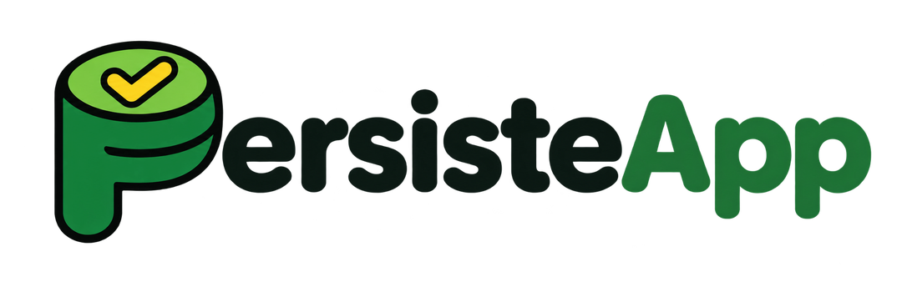
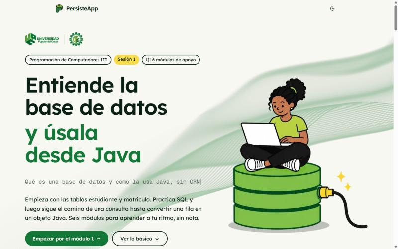
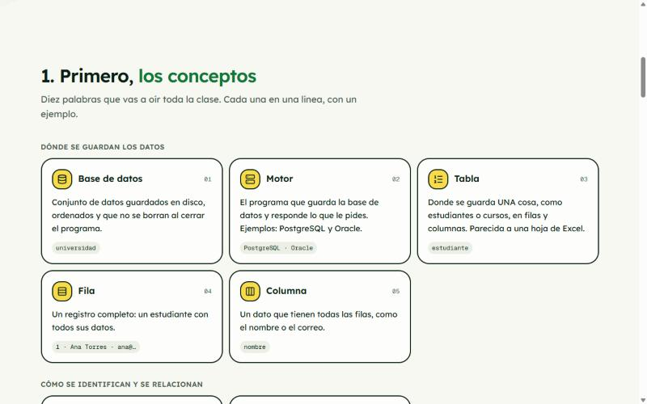
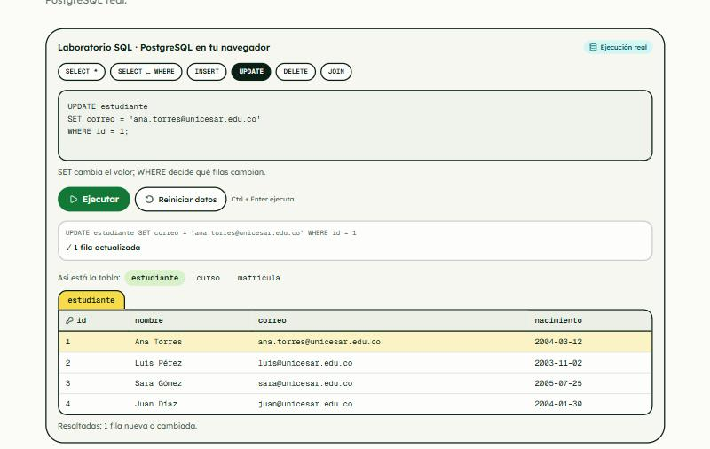
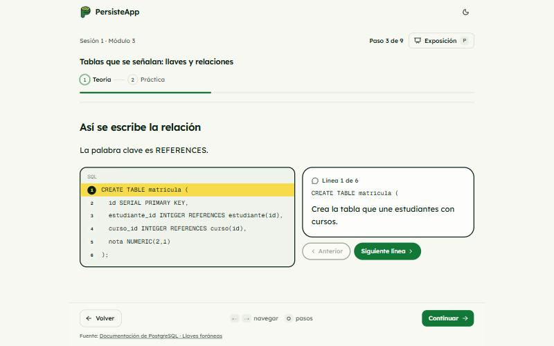
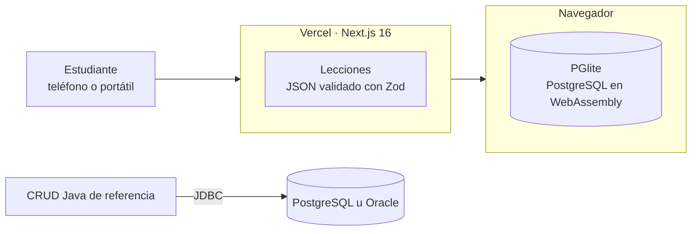

<div align="center">

<picture>
  <source media="(prefers-color-scheme: dark)" srcset="docs/logo/persisteapp-oscuro.png" />
  
</picture>

<h3>Lo que registras, queda guardado.</h3>

Plataforma interactiva para entender qué es una base de datos y cómo Java se conecta a ella **sin ORM**:<br/>
tablas, SQL, llaves, transacciones, JDBC y el paso de filas a objetos, con PostgreSQL y Oracle.

[](https://persisteapp.vercel.app)

<a href="#stack"></a>

[**Abrir la app**](https://persisteapp.vercel.app) · [Rumbo actual](specs/04-rumbo-teoria-bd.md) · [Requisitos](specs/01-requirements.md) · [CRUD Java](crud/README.md)

</div>

<p align="center">
  
</p>

## Contexto

PersisteApp acompaña la **sesión 1 de persistencia** de *Programación de Computadores III* (Ingeniería de Sistemas, Universidad Popular del Cesar). Reemplaza las diapositivas por un recorrido que el docente proyecta y el estudiante sigue en su teléfono o portátil.

La sesión **empieza por la teoría**: qué es una base de datos, cómo se le habla con SQL, cómo se relacionan las tablas y qué es una transacción. Después muestra cómo Java llega a esa tabla **sin ORM**: el viaje de una consulta, la equivalencia tabla ↔ clase y el código que copia cada fila a un objeto.

- **Docente:** Ing. Esp. Alfredo David Bautista Romero
- **Autor:** [Daniel David Turizo Chacón](https://github.com/ddturizo-eng)

## Qué incluye

| | |
|---|---|
| **6 módulos, 78 minutos** | 3 de teoría de bases de datos y 3 de Java sin ORM. Cada módulo va de la teoría a la práctica, una idea por pantalla. |
| **Conceptos primero** | La portada define tabla, fila, columna, consulta, llaves y transacción antes de mostrar código. |
| **Editor SQL real** | PostgreSQL corre en el navegador con [PGlite](https://pglite.dev): `SELECT`, `INSERT`, `UPDATE`, `DELETE`, `JOIN` y transacciones sobre las tablas `curso`, `estudiante` y `matricula`, con errores traducidos y las filas cambiadas resaltadas. |
| **Visuales interactivos** | Memoria frente a disco, anatomía de una tabla, PostgreSQL frente a Oracle, los cuatro verbos, una tabla gigante frente a tablas separadas, mapa de relaciones, todo o nada y de la fila al objeto. |
| **Código explicado** | Ningún código va solo: cada línea se toca y dice en palabras simples qué hace. |
| **Modo Exposición** | Tecla `P`: oculta la navegación y agranda el contenido para el proyector, con cronómetro. |
| **Accesible** | Teclado completo, contraste WCAG AA en tema claro y oscuro, 375 px sin scroll horizontal, progreso local por módulo. |

### Módulos de la sesión 1

| # | Módulo | Min |
|---|---|---|
| 1 | Dónde viven los datos cuando apagas el programa | 10 |
| 2 | Cuatro verbos para hablarle a una tabla | 15 |
| 3 | Tablas que se señalan: llaves y relaciones | 15 |
| 4 | El viaje de una consulta | 10 |
| 5 | De la tabla a la clase | 15 |
| 6 | Sin ORM: tú escribes el puente | 13 |

<table>
  <tr>
    <td width="50%"></td>
    <td width="50%"></td>
  </tr>
  <tr>
    <td colspan="2"></td>
  </tr>
</table>

> **Versión anterior.** La primera versión (8 módulos de JDBC, pool, inyección SQL, quiz en vivo y panel docente) quedó en la rama [`respaldo/main-quiz-v1`](https://github.com/ddturizo-eng/PersisteApp/tree/respaldo/main-quiz-v1). El código del quiz y del panel sigue en el repositorio, pero la portada ya no lo enlaza: esta sesión no se califica.

## Arquitectura



- **Contenido como datos.** Cada lección es un JSON tipado en `web/content/s1/`; un solo reproductor dibuja todos los pasos. El esquema se valida en el build.
- **Base de datos en el navegador.** El editor SQL carga PGlite solo cuando se abre: cada estudiante tiene su propia copia de las tablas de ejemplo y no hay servidor de base de datos.
- **Simulación rotulada.** Lo que corre en PostgreSQL real dice **Ejecución real**; lo animado dice **Simulación**.

Las reglas completas están en [`specs/00-constitution.md`](specs/00-constitution.md).

## Stack

| Capa | Tecnología |
|---|---|
| Web | Next.js 16 (App Router), React 19, TypeScript, Tailwind CSS 4 |
| Interfaz | React Aria Components, lucide-react, GSAP |
| Código resaltado | Shiki (temas GitHub claro y oscuro, ajustados a contraste AA) |
| Validación | Zod |
| Base de datos en el navegador | PGlite (PostgreSQL en WebAssembly) |
| Pruebas | Vitest |
| Despliegue | Vercel |
| CRUD de referencia | Java 17, Maven, JDBC, HikariCP; PostgreSQL u Oracle |

## Estructura

```
PersisteApp/
├── web/                  App Next.js
│   ├── app/              Rutas: portada y /s1/[lección] (/s1/quiz, /sala y /docente quedan ocultas)
│   ├── components/db/    Editor SQL, tablas, relaciones, código explicado y demás visuales
│   ├── components/       Reproductor de lecciones y componentes de interfaz
│   ├── content/s1/       Lecciones (JSON)
│   ├── lib/              Lógica pura: esquema de lecciones y base de datos de ejemplo
│   ├── supabase/         SQL del quiz (versión anterior)
│   └── tests/            Pruebas con Vitest
├── crud/                 CRUD Java de referencia (v0 desordenado y v1 en capas)
├── specs/                Constitución, requisitos, diseño, tareas y rumbo actual (SDD)
├── roadmap/              Roadmap estilo Jira e importación CSV
└── docs/                 Capturas, logo, investigación de UI e ilustraciones
```

## Empezar

Requisitos: **Node.js 20.9 o superior** (recomendado 22 LTS) y npm.

```bash
git clone https://github.com/ddturizo-eng/PersisteApp.git
cd PersisteApp/web
npm install
npm run dev
```

Abre <http://localhost:3000>. No hace falta ninguna variable de entorno ni base de datos: el editor SQL corre en el navegador.

### CRUD Java

El CRUD de consola de referencia tiene su propia guía: [`crud/README.md`](crud/README.md).

## Scripts

Desde `web/`:

| Comando | Qué hace |
|---|---|
| `npm run dev` | Servidor de desarrollo |
| `npm run build` | Valida el contenido y compila para producción |
| `npm start` | Sirve el build |
| `npm test` | Pruebas con Vitest |
| `npm run lint` | ESLint |
| `npm run validate:content` | Solo valida las lecciones |

Las pruebas cubren el esquema de las lecciones, la calidad de las preguntas (longitud de opciones, orden barajado) y la base de datos de ejemplo: las llaves foráneas son válidas y cada consulta del editor corre en PGlite (solo fallan, a propósito, las que rompen una llave).

## Cómo se construyó

El proyecto sigue **Spec-Driven Development**: constitución → requisitos (`REQ-xx` con criterios de aceptación) → diseño → tareas (`T-xx`) → código → verificación. Se construyó en tres días, del 6 al 8 de noviembre de 2026, para la sesión del 9 de noviembre. El 8 de noviembre el rumbo cambió hacia la teoría de bases de datos ([spec 04](specs/04-rumbo-teoria-bd.md)).

- [Constitución](specs/00-constitution.md) · [Requisitos](specs/01-requirements.md) · [Diseño](specs/02-design.md) · [Tareas](specs/03-tasks.md) · [Rumbo teoría de BD](specs/04-rumbo-teoria-bd.md) · [Roadmap](roadmap/ROADMAP.md)

## Apoya el proyecto

Si PersisteApp te sirvió para aprender o para enseñar, **dale una ⭐ al repositorio**: ayuda a que más estudiantes lo encuentren.

<div align="center">

Hecho por [Daniel David Turizo Chacón](https://github.com/ddturizo-eng) · Universidad Popular del Cesar

</div>
