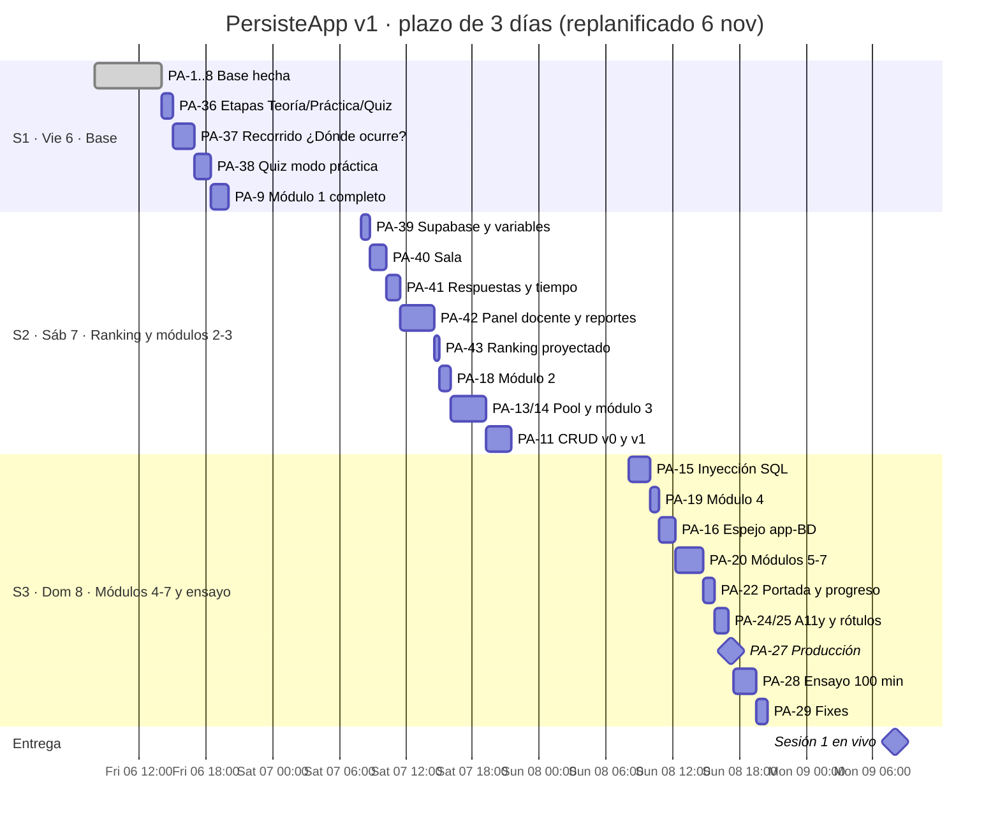

# PersisteApp · Roadmap (estilo Jira)

> Proyecto Jira sugerido: **PersisteApp**, clave `PA`. Tablero Scrum con tres sprints de un día. Cada issue `PA-n` corresponde a la tarea `T-n` de [`specs/03-tasks.md`](../specs/03-tasks.md); los requisitos están en [`specs/01-requirements.md`](../specs/01-requirements.md).
> Importable con [`jira-import.csv`](jira-import.csv) (ver instrucciones al final).
> **Replanificado el 6 nov 2026 a mediodía:** teoría primero y módulos en orden, recorrido «¿Dónde ocurre?», quiz por módulo y ranking por grupo (REQ-26 a REQ-30).

## Escala de estimación

| Story points | Horas aprox. |
|---|---|
| 1 | ≤ 0.5 h |
| 2 | 0.75–1 h |
| 3 | 1.25–1.75 h |
| 5 | 2–2.5 h |
| 8 | 3 h |

Capacidad por sprint: ~12 h ≈ 27–30 SP.

## Épicas

| Épica | Nombre | Objetivo | Sprint(s) |
|---|---|---|---|
| PA-E1 | Fundaciones de plataforma | App, esquema, reproductor, exposición, etapas, recorrido y quiz | S1 |
| PA-E2 | Investigación UI | Referencias con `ui-reference-intelligence` | S1 |
| PA-E3 | Simuladores interactivos | Pool, inyección SQL, espejo app ↔ BD | S2, S3 |
| PA-E4 | Contenido sesión 1 | Módulos 1 a 7 en orden, teoría → práctica → quiz | S1, S2, S3 |
| PA-E5 | CRUD de referencia Java | v0 desordenado y v1 con capas | S2 |
| PA-E6 | Navegación y accesibilidad | Portada, progreso, a11y, rótulos | S3 |
| PA-E7 | Lanzamiento y ensayo | Despliegues, respaldo sin red, ensayo | S1, S3 |
| PA-E10 | **Quiz y ranking por grupo** | Supabase, sala, puntaje en servidor, panel docente, CSV | S2 |
| PA-E8 | Sesión 2 *(backlog)* | Rutinas, triggers, CRUD v2 | Lun 9–Mar 10 |
| PA-E9 | Fase 2 *(backlog)* | Ejecución Java aislada, esquemas, cuentas, rúbrica | Por definir |

## Cronograma

## Sprint 1 · Vie 6 nov · "Base" — 32 SP (19 hechos)

**Meta:** módulo 1 completo y desplegado, con teoría, recorrido y quiz en modo práctica.

| Clave | Tipo | Resumen | Épica | SP | Estado | REQ |
|---|---|---|---|---|---|---|
| PA-1 | Task | Repo y app Next.js + TS + Tailwind + Vitest | E1 | 2 | Hecho | — |
| PA-2 | Task | Primer despliegue en Vercel | E7 | 1 | Hecho | — |
| PA-3 | Task | Investigación UI | E2 | 2 | Hecho | 02, 04, 05, 09 |
| PA-4 | Story | Tokens, temas y componentes base | E1 | 2 | Hecho | 07, 09 |
| PA-5 | Story | Esquema de lecciones validado en build | E1 | 2 | Hecho | 01 |
| PA-6 | Story | LessonPlayer | E1 | 5 | Hecho | 02, 03 |
| PA-7 | Story | Paso de código, ejercicios, pistas y «Ver solución» | E1 | 3 | Hecho | 04 |
| PA-8 | Story | Modo Exposición | E1 | 1 | En revisión | 05 |
| PA-36 | Story | Etapas Teoría → Práctica → Quiz | E1 | 2 | Por hacer | 26 |
| PA-37 | Story | Recorrido «¿Dónde ocurre?» | E1 | 5 | Por hacer | 27 |
| PA-38 | Story | Quiz en modo práctica calificado en servidor | E1 | 3 | Por hacer | 29 |
| PA-9 | Story | Lección modelo: módulo 1 «Mapa del sistema» | E4 | 3 | Hecho | 16, 26 |
| PA-12 | Task | Preguntas abiertas al docente | E7 | 1 | Por hacer | — |

## Sprint 2 · Sáb 7 nov · "Ranking y módulos 2–3" — 31 SP (sobre capacidad; ver regla de recorte)

**Meta:** landing de conceptos, quiz final y ranking por grupo de punta a punta con una sala de prueba; módulos 1–3 completos.

> Cambio del 6 nov (tarde): un solo quiz final de 12 preguntas que abre el docente; módulos en Teoría → Práctica; la portada pasa a landing de conceptos y se adelanta (REQ-26, 29, 33, 34).

| Clave | Tipo | Resumen | Épica | SP | REQ |
|---|---|---|---|---|---|
| PA-39 | Task | Proyecto Supabase, scripts SQL y variables en Vercel | E10 | 2 | 19, 28 |
| PA-40 | Story | Sala: entrar con código, nombre y código estudiantil | E10 | 3 | 28 |
| PA-46 | Story | Quiz final de 12 preguntas; módulos sin etapa Quiz y «Siguiente módulo» | E4 | 3 | 26, 29 |
| PA-47 | Story | Landing de conceptos interactiva con identidad UPC | E6 | 8 | 33, 06 |
| PA-41 | Story | «Prepárate para el quiz», tiempo en servidor, primer intento, puntaje y posición | E10 | 3 | 29, 30, 34 |
| PA-42 | Story | Panel docente: salas, En vivo, Por pregunta, Por estudiante, CSV | E10 | 8 | 28, 30, 31 |
| PA-43 | Story | Ranking proyectado top 10 | E10 | 1 | 30 |
| PA-18 | Story | Módulo 2 «Primera conexión» con recorrido | E4 | 2 | 16, 26, 27 |
| PA-13 | Task | Modelo puro del pool con pruebas | E3 | 2 | 10 |
| PA-14 | Story | Simulador de pool y módulo 3 | E3 | 5 | 10, 16 |
| PA-11 | Story | CRUD Java v0 y v1 contra Supabase | E5 | 5 | 17, 18 |

## Sprint 3 · Dom 8 nov · "Módulos 4–7 y ensayo" — 28 SP

**Meta:** sesión 1 con módulos 1–7, quiz y ranking, desplegada y ensayada. **Fin del plazo.**

| Clave | Tipo | Resumen | Épica | SP | REQ |
|---|---|---|---|---|---|
| PA-15 | Story | Laboratorio de inyección SQL | E3 | 5 | 11 |
| PA-19 | Story | Módulo 4 migrado a teoría → práctica → quiz | E4 | 2 | 16, 26 |
| PA-16 | Story | Espejo app ↔ base de datos | E3 | 3 | 12 |
| PA-20 | Story | Módulos 5, 6 y 7 con quiz | E4 | 5 | 16, 26, 29 |
| PA-22 | Story | Progreso local en el índice de la landing (la portada la reemplaza PA-47) | E6 | 1 | 06 |
| PA-24 | Task | Accesibilidad y responsive | E6 | 2 | 09 |
| PA-25 | Task | Auditoría de rótulos | E6 | 1 | 07 |
| PA-27 | Task | Producción y respaldo sin red | E7 | 1 | — |
| PA-28 | Task | Ensayo de 100 min con sala de prueba | E7 | 5 | — |
| PA-29 | Task | Corregir fallos del ensayo | E7 | 2 | — |

## Backlog

| Clave | Resumen | Épica | Motivo |
|---|---|---|---|
| PA-23 | Buscador Ctrl K, Referencia y glosario | E6 | Recorte del 6 nov |
| PA-26 | Revisión de acabado con `impeccable` | E2 | Recorte del 6 nov |
| PA-17 / PA-21 | PGlite: spike y laboratorio SQL real | E3 | Stretch |
| PA-44 | Módulo 8 «Qué hace Spring Boot por ti» | E4 | Estudio autónomo, después del lunes |
| PA-31–PA-35 | Sesión 2 | E8 | Lun 9 tarde y Mar 10 |
| PA-45–PA-51 | Fase 2 (editor Java, esquemas, cuentas, rúbrica, jurado, refactor, fugas) | E9 | Por definir |

## Ruta crítica

`PA-36 → PA-37 → PA-38 → PA-9 → PA-39 → PA-40 → PA-46 → PA-41 → PA-42 → PA-27 → PA-28`

El ranking depende de que el proyecto Supabase y sus claves estén en Vercel (PA-39) el sábado temprano. Sin VPS: todo corre en funciones serverless de Vercel + Supabase (P11).

## Flujo de estados del tablero

`Por hacer → En curso → En revisión (DoD + criterios REQ) → Hecho`

## Importar en Jira

1. Crear el proyecto Scrum con clave `PA` y los sprints `PA Sprint 1 · Vie 6`, `PA Sprint 2 · Sáb 7`, `PA Sprint 3 · Dom 8`.
2. Configuración del proyecto → **Importar issues desde CSV** → subir `jira-import.csv`.
3. Mapear: `Issue Id` → Issue Id, `Parent Id` → Parent Id, `Story Points` → Story Points, `Original Estimate` → Original Estimate (segundos), `Sprint` → Sprint, `Status` → Status.
4. Jira asigna claves nuevas al importar; el campo `Labels` incluye `T-xx` para mantener la trazabilidad con las specs.
