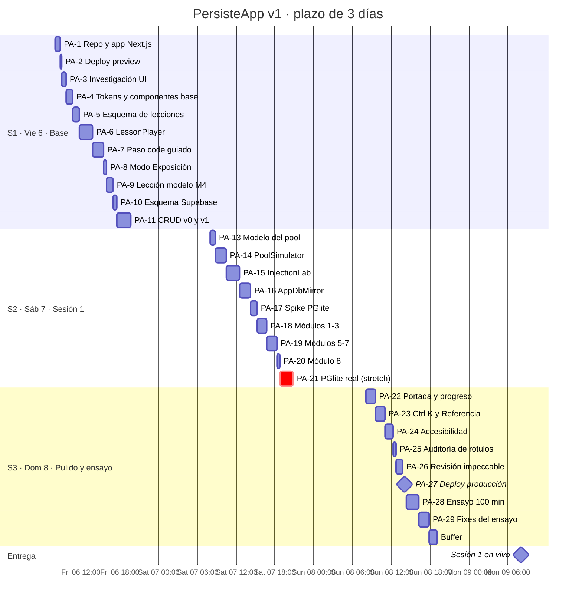

# PersisteApp · Roadmap (estilo Jira)

> Proyecto Jira sugerido: **PersisteApp**, clave `PA`. Tablero Scrum con tres sprints de un día. Cada issue `PA-n` corresponde a la tarea `T-n` de [`specs/03-tasks.md`](../specs/03-tasks.md); los requisitos están en [`specs/01-requirements.md`](../specs/01-requirements.md).
> Importable con [`jira-import.csv`](jira-import.csv) (ver instrucciones al final).

## Escala de estimación

| Story points | Horas aprox. |
|---|---|
| 1 | ≤ 0.5 h |
| 2 | 0.75–1 h |
| 3 | 1.25–1.75 h |
| 5 | 2–2.5 h |

Capacidad por sprint: ~12 h ≈ 25–27 SP.

## Épicas

| Épica | Nombre | Objetivo | Sprint(s) | SP |
|---|---|---|---|---|
| PA-E1 | Fundaciones de plataforma | App Next.js, esquema de lecciones, reproductor de pasos, modo exposición | S1 | 15 |
| PA-E2 | Investigación y acabado UI | Referencias con `ui-reference-intelligence`, revisión final con `impeccable` | S1, S3 | 4 |
| PA-E3 | Simuladores interactivos | Pool, inyección SQL, espejo app ↔ BD, PGlite | S2 | 20 |
| PA-E4 | Contenido sesión 1 | Ocho módulos con el recorrido de seis etapas | S1, S2 | 9 |
| PA-E5 | CRUD de referencia Java | v0 desordenado, v1 con capas, base en Supabase | S1 | 6 |
| PA-E6 | Navegación, búsqueda y accesibilidad | Portada, progreso, Ctrl K, referencia, a11y | S3 | 10 |
| PA-E7 | Lanzamiento y ensayo | Despliegues, respaldo offline, ensayo de 100 min | S1, S3 | 9 |
| PA-E8 | Sesión 2 *(backlog, fuera del plazo)* | Rutinas, triggers, CRUD v2 | Lun 9–Mar 10 | — |
| PA-E9 | Fase 2 *(backlog)* | Ejecución Java aislada, esquemas, cuentas, rúbrica | Por definir | — |

## Cronograma

## Sprint 1 · Vie 6 nov · "Base" — 27 SP

**Meta:** una lección real recorrible en modo exposición, desplegada; CRUD v0/v1 contra Supabase.

| Clave | Tipo | Resumen | Épica | SP | Prioridad | REQ |
|---|---|---|---|---|---|---|
| PA-1 | Task | Inicializar repo y app Next.js + TS + Tailwind + Vitest | E1 | 2 | Highest | — |
| PA-2 | Task | Primer despliegue preview en Vercel | E7 | 1 | High | — |
| PA-3 | Task | Investigación UI con `ui-reference-intelligence` | E2 | 2 | High | 02, 04, 05, 09 |
| PA-4 | Story | Tokens, tema claro/oscuro y componentes base (`ExecutionBadge`) | E1 | 2 | Highest | 07, 09 |
| PA-5 | Story | Esquema zod y carga validada de lecciones | E1 | 2 | Highest | 01 |
| PA-6 | Story | LessonPlayer con pasos text, visual y question | E1 | 5 | Highest | 02, 03 |
| PA-7 | Story | Paso code: pestañas de motor y ejercicios guiados | E1 | 3 | Highest | 04 |
| PA-8 | Story | Modo Exposición para proyector | E1 | 1 | High | 05 |
| PA-9 | Story | Lección modelo: módulo 4 Consultas seguras | E4 | 2 | Highest | 16 |
| PA-10 | Task | Esquema y semilla en Supabase (products, sales) | E5 | 1 | High | 19 |
| PA-11 | Story | CRUD Java v0 desordenado y v1 con capas | E5 | 5 | Highest | 17, 18 |
| PA-12 | Task | Enviar preguntas abiertas al docente | E7 | 1 | Medium | — |

## Sprint 2 · Sáb 7 nov · "Sesión 1" — 22 SP + 5 SP stretch

**Meta:** los 8 módulos recorribles y los tres simuladores Must funcionando.

| Clave | Tipo | Resumen | Épica | SP | Prioridad | REQ |
|---|---|---|---|---|---|---|
| PA-13 | Task | Modelo puro del pool con pruebas | E3 | 2 | Highest | 10 |
| PA-14 | Story | Simulador de pool con y sin pool | E3 | 3 | Highest | 10 |
| PA-15 | Story | Laboratorio de inyección SQL | E3 | 5 | Highest | 11 |
| PA-16 | Story | Espejo app ↔ base de datos (MemoryDb) | E3 | 3 | Highest | 12 |
| PA-17 | Task | Spike PGlite (timebox 1 h) | E3 | 2 | Medium | 15, 20 |
| PA-18 | Story | Contenido módulos 1, 2 y 3 + mapa del sistema | E4 | 3 | Highest | 13, 16 |
| PA-19 | Story | Contenido módulos 5, 6 y 7 | E4 | 3 | Highest | 16 |
| PA-20 | Story | Contenido módulo 8 (Spring Boot, opcional) | E4 | 1 | Medium | 06, 16 |
| PA-21 | Story | *Stretch:* PGlite real en el espejo y `/lab/sql` | E3 | 5 | Low | 12, 15 |

## Sprint 3 · Dom 8 nov · "Pulido y ensayo" — 19 SP + buffer

**Meta:** sesión 1 en producción, ensayada y con respaldo offline. **Fin del plazo.**

| Clave | Tipo | Resumen | Épica | SP | Prioridad | REQ |
|---|---|---|---|---|---|---|
| PA-22 | Story | Portada, índice del curso y progreso local | E6 | 3 | Medium | 06 |
| PA-23 | Story | Buscador Ctrl K, Referencia y glosario | E6 | 3 | Medium | 08 |
| PA-24 | Task | Pasada de accesibilidad y responsive | E6 | 3 | Highest | 09 |
| PA-25 | Task | Auditoría de rótulos real/simulado | E6 | 1 | Highest | 07 |
| PA-26 | Task | Revisión de acabado con `impeccable` | E2 | 2 | High | — |
| PA-27 | Task | Despliegue de producción y respaldo offline | E7 | 1 | Highest | — |
| PA-28 | Task | Ensayo completo de 100 min | E7 | 3 | Highest | — |
| PA-29 | Task | Corregir fallos del ensayo | E7 | 3 | Highest | — |

## Backlog fuera del plazo

| Clave | Tipo | Resumen | Épica | Cuándo |
|---|---|---|---|---|
| PA-31 | Story | CRUD v2 con CallableStatement y errores traducidos | E8 | Lun 9 tarde |
| PA-32 | Task | Scripts de rutinas y trigger de bitácora (Oracle y PostgreSQL) | E8 | Lun 9 tarde |
| PA-33 | Story | Contenido módulos S2-1 a S2-7 | E8 | Mar 10 |
| PA-34 | Story | Visual del trigger en paralelo | E8 | Mar 10 |
| PA-35 | Task | Ensayo sesión 2 | E8 | Mar 10 |
| PA-36 | Story | Editor Java ejecutable en contenedor aislado | E9 | Fase 2 |
| PA-37 | Story | Esquema por estudiante restaurable | E9 | Fase 2 |
| PA-38 | Story | Cuentas y progreso sincronizado en Supabase | E9 | Fase 2 |
| PA-39 | Story | Rúbrica automatizada | E9 | Fase 2 |
| PA-40 | Story | Revisión tipo jurado (8 defectos) | E9 | Fase 2 |
| PA-41 | Story | Refactor guiado SOLID/GRASP | E9 | Fase 2 |
| PA-42 | Story | Detector de fugas de conexiones | E9 | Fase 2 |
| PA-43 | Story | Rastreador de petición (REQ-14) | E3 | Si sobra buffer, si no Fase 2 |

## Ruta crítica

`PA-1 → PA-4/PA-5 → PA-6 → PA-7 → PA-9 → (PA-15, PA-18, PA-19) → PA-24 → PA-27 → PA-28`

Si cualquier issue de esta ruta se atrasa más de 1 h, se aplican las reglas de recorte de `specs/03-tasks.md`.

## Flujo de estados del tablero

`Por hacer → En curso → En revisión (DoD + criterios REQ) → Hecho`

Una issue pasa a Hecho solo si cumple el DoD común y los criterios de aceptación de sus REQ.

## Importar en Jira

1. Crear el proyecto Scrum con clave `PA` y los sprints `PA Sprint 1 · Vie 6`, `PA Sprint 2 · Sáb 7`, `PA Sprint 3 · Dom 8`.
2. Configuración del proyecto → **Importar issues desde CSV** → subir `jira-import.csv`.
3. Mapear: `Issue Id` → Issue Id, `Parent Id` → Parent Id (enlaza historias con épicas), `Story Points` → Story Points, `Original Estimate` → Original Estimate (en segundos), `Sprint` → Sprint.
4. Jira asigna claves nuevas al importar; el campo `Labels` incluye `T-xx` para mantener la trazabilidad con las specs.
